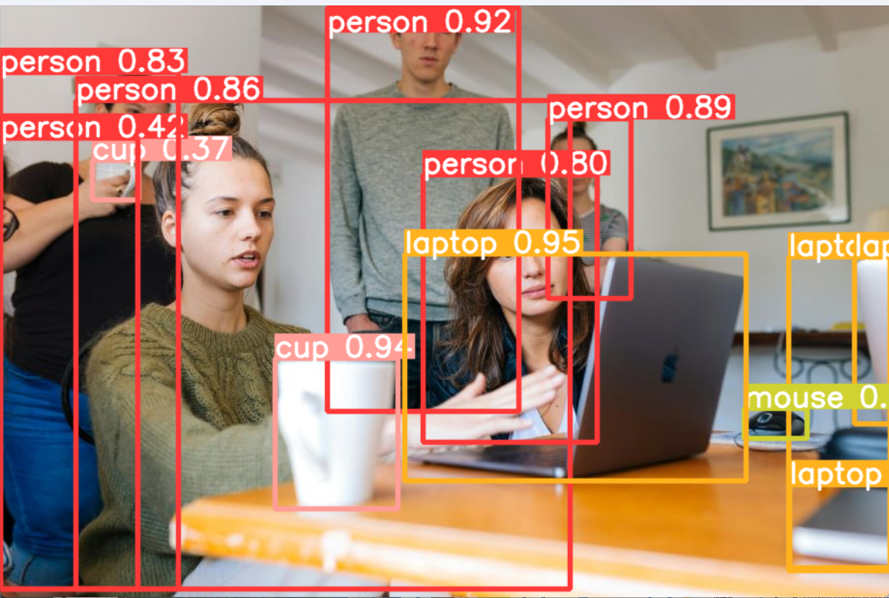
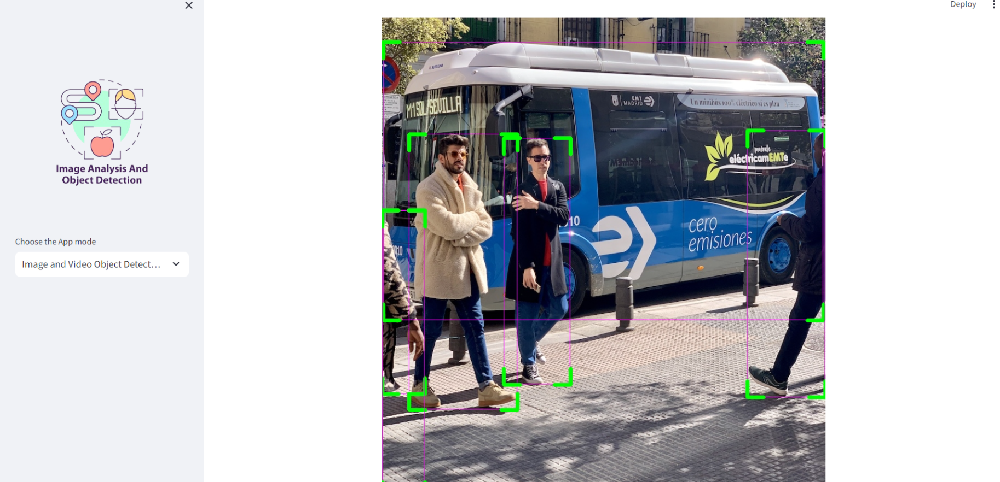

# People Counter and Object Detection with YOLOv8

## Overview

This project implements object detection, tracking, and people counting using **YOLOv8** and the **SORT tracking algorithm**.

The application uses pre-trained YOLOv8 models on the COCO dataset to detect objects in images and videos. It also provides a people counting feature by tracking individuals across video frames.

A user-friendly interface is developed using **Streamlit** to visualize detection and tracking results.

## Features

- **Object Detection:** Detect objects using YOLOv8.
- **Object Tracking:** Track detected objects using the SORT algorithm.
- **People Counting:** Count people in video sequences.
- **Image and Video Processing:** Perform detection on images and videos.
- **Visualization:** Display bounding boxes around detected objects.

## Technologies Used

- Python
- YOLOv8 (Ultralytics)
- OpenCV
- SORT Algorithm
- Streamlit
- NumPy
- Pandas
- CVZone

## Project Structure

- `main.py` – Main application for object detection and tracking.
- `sort.py` – SORT algorithm for object tracking.
- `yolo-weights/` – Pre-trained YOLOv8 model weights.

## Installation

**1. Clone the repository**

```bash
git clone https://github.com/nassimelaouad/people-counter-object-detection.git
cd people-counter-object-detection
```

**2. Install dependencies**

```bash
pip install streamlit ultralytics opencv-python numpy pandas pillow cvzone filterpy scipy
```

**3. Run the application**

```bash
streamlit run main.py
```

## Results

The application detects objects and displays bounding boxes around them. The SORT algorithm helps maintain consistent object IDs across video frames, enabling people tracking and counting.

## Application Preview




## License

This project is licensed under the MIT License.
